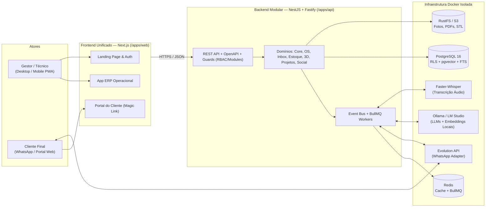

# 02 — Arquitetura Técnica, Diagramas C4 e ADRs

> **Estilo Arquitetural:** Monólito Modular Orientado a Eventos (*Modular Monolith + Domain Events*)  
> **Padrão de Isolamento:** Multi-Tenant com Row-Level Security (RLS) no PostgreSQL

---

## 1. Visão Geral (C4 — Contexto e Containers)

A arquitetura evita a complexidade prematura de microsserviços mantendo **limites rígidos de domínio** dentro do backend NestJS. Cada módulo só se comunica com outro através de **interfaces de serviço públicas** ou **eventos assíncronos**, permitindo extrair qualquer módulo pesado no futuro sem reescrever regras de negócio.

---

## 2. Mecanismo de Modularidade e Entitlements

Para suportar a venda da plataforma por módulos sem duplicação de código:

1. **Registro Central de Módulos (`@al/shared`):** define o catálogo imutável de IDs de módulo (`core`, `mod-service-orders`, `mod-ai-agents`, `mod-inventory-pos`, `mod-finance-fiscal`, `mod-3d-print`, `mod-projects-dev`, `mod-social-growth`), suas dependências e permissões associadas.
2. **Enforce na API (`ModuleEntitlementGuard`):**
   - Todo controller de módulo específico recebe o decorator `@RequireModule('mod-3d-print')`.
   - Na entrada da requisição, o Guard lê os módulos ativos do tenant (em cache Redis com invalidação na troca de plano) e retorna `403 MODULE_NOT_ENABLED` caso não esteja contratado.
3. **Desacoplamento por Eventos:**
   - Quando uma OS é finalizada (`repair.completed`), o módulo de OS não importa o módulo de WhatsApp nem o de Social Media. Ele apenas publica `repair.completed` no Event Bus.
   - O `mod-ai-agents` escuta esse evento **se e somente se** o tenant possuir o módulo ativo; o `mod-inventory-pos` escuta `repair.parts_confirmed` para efetivar a baixa de estoque, e assim por diante.

---

## 3. Multi-Tenancy Real com PostgreSQL RLS

Confiar apenas em `WHERE tenant_id = ?` escrito manualmente por desenvolvedores ou agentes de IA gera risco crítico de vazamento entre empresas em SaaS. Por isso adotamos **dupla proteção**:

1. **Nível de Aplicação:** Middleware extrai `organizationId` do token autenticado e injeta no contexto da requisição.
2. **Nível de Banco (RLS):**
   - Toda tabela de negócio possui `organization_id UUID NOT NULL`.
   - As queries operacionais executam dentro de um wrapper de transação Drizzle que define `SET LOCAL app.current_tenant_id = '<uuid>'`.
   - As políticas de `ROW LEVEL SECURITY` no PostgreSQL garantem que mesmo uma query mal escrita nunca retorne ou altere linhas de outro tenant.

---

## 4. Isolamento do Ambiente de Desenvolvimento

Para evitar conflitos com instalações globais na máquina do desenvolvedor:
- **Runtime Node.js:** fixado via `.nvmrc` (`24`) e campo `engines` + `engine-strict=true` no `.npmrc`.
- **Gerenciador de Pacotes:** `pnpm` com workspace estrito (`shamefully-hoist=false`), garantindo que nenhum pacote acesse dependências fantasmas.
- **Serviços Externos (Banco, Redis, Storage, WhatsApp, IA):** 100% containerizados em `infra/docker/docker-compose.yml` com rede dedicada e volumes locais dentro do próprio repositório (`infra/docker/volumes/` — ignorados pelo Git).
- **Zero segredos versionados:** `.env` é local e ignorado; apenas `.env.example` vai para o Git.

---

## 5. Architecture Decision Records (ADRs)

### ADR-001 — Monorepo TypeScript (Next.js + NestJS/Fastify) como Stack Principal
- **Contexto:** O sistema precisa compartilhar schemas de validação, design tokens, matriz de risco de IA e contratos de API entre frontend, backend, portal e workers assíncronos, além de ser desenvolvido com apoio intensivo de agentes de IA.
- **Decisão:** Adotar Turborepo + pnpm com **Next.js (App Router)** no frontend e **NestJS com adaptador Fastify** no backend.
- **Consequências:**
  - *Prós:* Tipagem compartilhada ponta a ponta com Zod; estrutura modular rigorosa do NestJS facilita manutenção por humanos e agentes; curva de deploy única.
  - *Contras:* Tarefas pesadas de ML/visão/slicing 3D no futuro (se necessário) devem rodar como containers worker externos acionados via BullMQ.

### ADR-002 — Drizzle ORM + PostgreSQL 16 (`pgvector`) sobre Prisma
- **Contexto:** Precisamos de multi-tenancy com Row-Level Security (`SET LOCAL`), queries analíticas/BI performáticas e suporte nativo a colunas vetoriais (`vector`) para RAG.
- **Decisão:** Utilizar **Drizzle ORM** com SQL migrations versionadas.
- **Consequências:**
  - *Prós:* Suporte nativo a transações com `SET LOCAL` para RLS, suporte direto a tipos `pgvector` e índices `HNSW`/`GIN`, sem engine binária pesada.
  - *Contras:* Exige cuidado disciplinado na revisão das migrations geradas (mitigado por CI checks).

### ADR-003 — Arquitetura AI Gateway *Local-First* com Fallback Híbrido
- **Contexto:** Dados de clientes (CPF, endereço, senhas de equipamentos, conversas de WhatsApp) são sensíveis à LGPD e geram alto volume de chamadas repetitivas.
- **Decisão:** Construir o pacote `@al/ai-core` com interface `AIProvider` sobre o **Vercel AI SDK**, roteando por padrão para **Ollama / LM Studio** local e permitindo fallback opcional por tarefa/tenant para APIs externas (Gemini, OpenAI, Anthropic).
- **Consequências:**
  - *Prós:* Privacidade, previsibilidade de custo e operação offline-ready para triagem/resumos.
  - *Contras:* Modelos locais menores têm menor capacidade em raciocínio complexo; mitigado com schemas Zod estritos, RAG bem estruturado e roteamento por complexidade da tarefa.

### ADR-004 — WhatsApp via Adapter (`Evolution API` no MVP → `Meta Cloud API` no SaaS)
- **Contexto:** A API Oficial da Meta tem fricção de aprovação comercial e custo por janela/template para validação inicial no balcão, mas é indispensável para escala SaaS sem risco de banimento.
- **Decisão:** Abstrair envio, recebimento de webhook e mídia por trás da interface `MessagingProvider`. Implementar `EvolutionProvider` primeiro e `MetaCloudProvider` na Fase SaaS.
- **Consequências:** O domínio de OS e Inbox nunca conhece detalhes do provedor de mensageria.

### ADR-005 — BullMQ + Redis para Eventos Assíncronos e Debounce de Conversas
- **Contexto:** Entrada de OS no balcão precisa responder em milissegundos, enquanto geração de PDF, envio de WhatsApp, transcrição de áudio e agendamento de posts sociais são operações lentas ou sujeitas a falhas de rede.
- **Decisão:** Adotar **Redis + BullMQ** para processamento assíncrono com retries exponenciais, *dead-letter queues* e janela de debounce (4s) no WhatsApp.
- **Consequências:** Resiliência contra quedas temporárias de API externa e UX instantânea no balcão.

### ADR-006 — Better Auth para Identidade, Organizações e Magic Links
- **Contexto:** Precisamos de autenticação segura para equipe interna (sessões, RBAC, MFA TOTP) e acesso simplificado sem senha para clientes no Portal (Magic Link vinculado à OS).
- **Decisão:** Utilizar **Better Auth** integrado ao PostgreSQL/Drizzle para equipe e tokens assinados de escopo limitado para o Portal do Cliente.
- **Consequências:** Reduz código de segurança artesanal mantendo controle total dos dados no nosso próprio banco.
