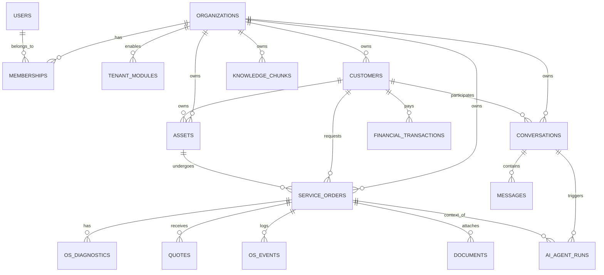

# 03 — Engenharia de Dados, ERD e Pipeline Analítico

> **Visão:** Além de sustentar a operação transacional (OLTP) com integridade e isolamento multi-tenant, o modelo de dados já nasce estruturado para **RAG (Busca Vetorial)**, **Auditoria Imutável** e **Ciência de Dados / BI** (previsão de estoque, propensão à recompra e observabilidade de IA).

---

## 1. Diagrama Entidade-Relacionamento (Núcleo + Core OS + IA)

---

## 2. Domínios de Tabelas no PostgreSQL

### 2.1 Multi-Tenancy, Auth & Modularidade
- `organizations`: `id`, `slug`, `name`, `cnpj`, `plan_code`, `settings (jsonb)`, `created_at`.
- `users` / `memberships`: vínculo N:N permitindo que um técnico ou consultor atenda múltiplas organizações com papéis (`role`: `owner`, `admin`, `technician`, `attendant`, `viewer`) e permissões granulares.
- `tenant_modules`: `(organization_id, module_code)` com `enabled (boolean)`, `limits (jsonb)`, `config (jsonb)`, `activated_at`.

### 2.2 CRM & Inbox Omnichannel
- `customers`: `id`, `organization_id`, `type (PF|PJ)`, `name`, `document_encrypted`, `document_hash` (para busca exata sem expor texto puro em logs), `phone_e164`, `email`, `tags[]`, `lgpd_consent_at`, `ai_segment` (`VIP`, `RECURRING`, `AT_RISK`, etc.), `deleted_at`.
- `leads`: origem (`landing_page`, `whatsapp`, `instagram`, `walk_in`), estágio do funil, score de qualificação IA, `converted_customer_id`.
- `conversations`: `id`, `organization_id`, `customer_id`, `channel` (`whatsapp`, `web_portal`, `instagram`), `external_thread_id`, `bot_state` (`BOT_ACTIVE | WAITING_HUMAN | HUMAN_ACTIVE | PAUSED`), `assigned_user_id`, `handoff_reason`, `handoff_summary`, `last_message_at`.
- `messages`: `id`, `conversation_id`, `direction` (`inbound | outbound`), `sender_type` (`customer | human_agent | ai_agent | system`), `content_text`, `media_url`, `audio_transcript`, `provider_message_id` (chave de idempotência), `created_at`.

### 2.3 Ativos, OS, Diagnóstico & Orçamento
- `assets` (Equipamentos): `id`, `organization_id`, `customer_id`, `category`, `brand`, `model`, `serial_number`, `qr_code_token`, `specs (jsonb)` (CPU, RAM, armazenamento, GPU), `created_at`.
- `service_orders`: `id`, `organization_id`, `code` (sequencial legível por tenant, ex: `OS-2026-0042`), `customer_id`, `asset_id`, `status` (workflow configurável), `priority`, `intake_checklist (jsonb)`, `reported_symptoms`, `preliminary_diagnosis`, `portal_access_token_hash`, `promised_at`, `closed_at`.
- `os_diagnostics`: observações separadas explicitamente em `observed_facts`, `tests_performed (jsonb)`, `ai_hypotheses (jsonb)`, `final_diagnosis`, `confidence_level`.
- `quotes` & `quote_items`: propostas (`economic | recommended | premium`), itens (peça, mão de obra, terceirizado, deslocamento), prova de aceite (`accepted_at`, `ip_address`, `signature_hash`).

### 2.4 Estoque, Financeiro & Módulos Plugáveis
- `products` & `inventory_movements`: catálogo com taxonomia flexível, SKU/EAN, custo médio ponderado, estoque mínimo, movimentações imutáveis tipo *ledger* (`in | out | reserve | release | os_consume | sale`).
- `financial_transactions`: contas a pagar/receber, parcelas, centro de custo, vínculo com `service_order_id` ou `sale_id`, status no gateway (`Asaas`), conciliação.
- `print_3d_jobs` *(módulo 3D)*: arquivo STL/3MF no MinIO, peso em gramas, tempo estimado, material/filamento, cálculo de energia/depreciação, status na fila de impressora.
- `projects` / `tasks` / `time_entries` *(módulo Projetos)*: kanban, horas apontadas e saldo de contrato *retainer*.
- `social_posts` & `social_metrics` *(módulo Social Growth)*: rascunho gerado por IA, aprovação, agendamento, ID externo publicado, alcance/cliques/leads atribuídos.

### 2.5 IA, RAG, Auditoria e Telemetria
- `knowledge_documents` & `knowledge_chunks`: documentos indexados com `embedding vector(1024)` (compatível com `bge-m3` / `nomic-embed-text` via configuração), `content_tsvector` (FTS português) e metadados de fonte/página.
- `ai_agent_runs`: telemetria completa de cada execução agêntica (`agent_name`, `provider`, `model`, `prompt_tokens`, `completion_tokens`, `latency_ms`, `tools_called (jsonb)`, `risk_level`, `human_approval_status`, `feedback_score`).
- `audit_logs`: trilha imutável (*append-only*) com `actor_type` (`human | ai_agent | automation`), `actor_id`, `entity_type`, `entity_id`, `before_state`, `after_state`, `reason`, `created_at`.

---

## 3. Estratégia de Indexação e Busca Híbrida

| Caso de Uso | Tipo de Índice PostgreSQL | Benefício |
|---|---|---|
| Isolamento Multi-Tenant | Índice composto iniciando por `(organization_id, ...)` | Toda query com RLS evita *sequential scan* global. |
| Busca Global no Balcão (`⌘K`) | `GIN` com `pg_trgm` em `name`, `phone`, `serial_number`, `code` | Encontra cliente ou OS mesmo com erro de digitação em < 15ms. |
| Busca Lexical (RAG) | `GIN` em `to_tsvector('portuguese', content)` | Encontra códigos exatos de erro, modelos de placa e NCMs. |
| Busca Semântica (RAG) | `HNSW` (`vector_cosine_ops`) em `embedding` | Recupera procedimentos por significado ("notebook desliga quando esquenta"). |

---

## 4. Camada Analítica & Ciência de Dados (Data Science Readiness)

Mesmo operando no PostgreSQL inicialmente, os schemas evitam antipadrões que quebram análises futuras:

1. **Movimentações como Ledger (Append-Only):** estoque, eventos de OS (`os_events`) e transações financeiras nunca sobrescrevem o passado; cada mudança de estado gera uma linha com timestamp. Isso permite calcular **Lead Time exato por etapa da OS**, gargalos de bancada e **giro real de peças**.
2. **Views Materializadas / Camada Silver (BI):** criação futura de views materializadas (`mv_daily_kpis`, `mv_part_consumption_weekly`, `mv_customer_rfm`) atualizadas em horários de baixo movimento via BullMQ, sem travar o balcão.
3. **Casos de Uso de Data Science Planejados (Fase 6+):**
   - **Previsão de Demanda & Ponto de Reposição Dinâmico:** séries temporais sobre consumo de peças (SSDs, telas, baterias, filamentos) ajustadas por sazonalidade e OS abertas.
   - **RFM & Propensão a Churn/Recompra:** segmentação automática (Recência, Frequência, Valor Monetário) para o módulo de Pós-Atendimento sugerir limpeza preventiva ou upgrade.
   - **Detecção de Anomalias:** alerta estatístico (z-score / IQR) quando um reparo ultrapassa o tempo médio da categoria ou quando a margem de uma OS cai abaixo do limiar.
   - **Dataset de Fine-Tuning / Evals:** os logs de `ai_agent_runs` com correções feitas pelo técnico humano formam um *golden dataset* auditado (anonimizado) para avaliar e melhorar prompts e modelos locais.
