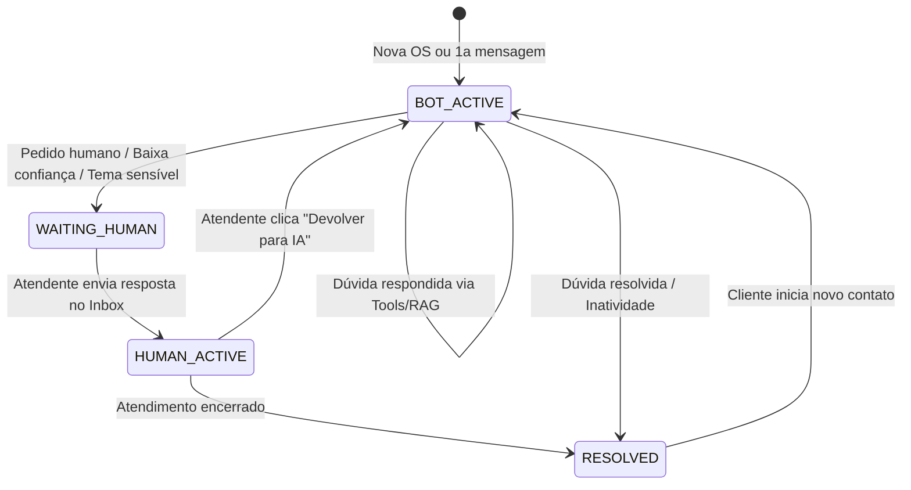

# 04 — IA Agêntica, RAG, Matriz de Risco e Ciência de Dados

> **Princípio Inegociável:** *Local-First AI* com **Privacidade (LGPD)** e **Human-in-the-Loop**. A IA é um copiloto operacional auditável, nunca uma caixa-preta com acesso irrestrito a ações destrutivas ou dados em nuvem sem consentimento.

---

## 1. AI Gateway & Roteamento de Modelos

Toda chamada de IA passa pelo pacote `@al/ai-core`, nunca diretamente por SDKs espalhados nos módulos. O roteador escolhe o provedor por **Política de Tarefa + Política de Privacidade do Tenant**:

| Tarefa | Provedor Padrão (Local-First) | Modelos Sugeridos | Fallback Nuvem (Opcional) | Dados Sensíveis? |
|---|---|---|---|---|
| **Transcrição de Áudio WhatsApp** | Faster-Whisper (Docker local) | `large-v3-turbo` / `small` (CPU) | OpenAI Whisper API | Sim (priorizar local) |
| **Triagem, Classificação & Debounce** | Ollama / LM Studio | `qwen2.5:7b` / `llama3.1:8b` | Gemini Flash / GPT-4o-mini | Sim (local) |
| **Agente WhatsApp (Dúvidas + Tools)** | Ollama / LM Studio | `qwen2.5:14b` ou `7b` com tool calling | Gemini / Claude / GPT | Sim (anonimizar se nuvem) |
| **Embeddings & RAG** | Ollama local | `bge-m3` (multilíngue PT-BR) | `text-embedding-3-small` | Sim (local) |
| **Diagnóstico Técnico & Propostas** | Ollama maior ou Nuvem | `qwen2.5:14b` / `deepseek-r1` | Claude / Gemini Pro | Médio |
| **Copy de Marketing / Landing / Social** | Local ou Nuvem | `qwen2.5` / `llama3.x` | Claude / Gemini | Não (dados públicos) |

> **Regra LGPD de Roteamento:** se a organização estiver com `ai_privacy_mode = 'strict_local'`, qualquer tentativa de enviar payload de cliente para API externa é bloqueada em nível de gateway e registrada em auditoria.

---

## 2. Pipeline de RAG (Base de Conhecimento Auditável)

Fontes suportadas: manuais técnicos de fabricantes, procedimentos internos (SOPs), política de garantia da loja, FAQ de atendimento, contratos-modelo e histórico anonimizado de reparos resolvidos.

```text
Upload (PDF/MD/DOCX)
  → Validação MIME/Tamanho & Hash SHA-256 (deduplicação)
  → Extração de texto / OCR local quando PDF escaneado
  → Chunking semântico (500–800 tokens com overlap de 80 tokens)
  → Geração de Embeddings (bge-m3) + tsvector (PT-BR)
  → Gravação em `knowledge_chunks` isolada por `organization_id` (RLS)
  → Consulta: Busca Híbrida (HNSW Vetorial + GIN Lexical) combinada via RRF (Reciprocal Rank Fusion)
  → Geração com citação obrigatória da fonte interna
```

Se a busca híbrida não retornar trechos acima do limiar de relevância, o agente responde: *"Não encontrei essa informação nos registros do sistema; vou encaminhar para um atendente confirmar para você."*

---

## 3. Matriz de Risco e Governança de Tools

Cada ferramenta registrada no `ToolRegistry` declara seu `riskLevel`, schema Zod de entrada/saída e política de aprovação:

| Nível de Risco | Exemplos de Tools | Execução |
|---|---|---|
| `READ_ONLY` | `get_customer_repair_orders`, `get_quote_details`, `search_knowledge_base`, `check_stock` | **Automática** (auditada) |
| `WRITE_SAFE` | `create_lead_draft`, `create_internal_task`, `escalate_conversation_to_human`, `save_quote_draft` | **Automática / Configurável** (reversível) |
| `WRITE_SENSITIVE` | `send_whatsapp_outbound_campaign`, `update_os_promised_date`, `publish_social_post` | **Requer aprovação humana** na fila |
| `CRITICAL` | `apply_discount_above_policy`, `issue_nfe`, `refund_payment`, `delete_record` | **Bloqueada para execução autônoma** (apenas humano após confirmação explícita) |

---

## 4. Máquina de Estados: WhatsApp Agêntico & Handoff Humano

Para evitar que o bot atropele um técnico que já assumiu o atendimento, toda conversa possui um estado explícito:



### Proteções Práticas no Worker BullMQ
1. **Janela de Debounce (4 segundos):** se o cliente enviar "Oi", depois um áudio de 8s e depois "o notebook já ficou pronto?", o worker consolida os 3 eventos antes de chamar o LLM uma única vez.
2. **Idempotência:** cada `provider_message_id` da Evolution API é deduplicado antes de entrar na fila, evitando respostas duplicadas em reenvios de webhook.
3. **Resumo de Handoff:** ao transicionar para `WAITING_HUMAN`, o agente gera um bloco curto no Inbox com: *Motivo do escalonamento + OS relacionada + Resumo das últimas mensagens*.

---

## 5. Ciência de Dados & Avaliação Contínua (Evals)

Qualidade de IA em produção exige medição objetiva, não "achar que o prompt ficou bom":

- **Telemetria em `ai_agent_runs` + Langfuse:** latência P50/P95, taxa de fallback para nuvem, tokens por conversa, *tool call error rate*.
- **Métricas de Atendimento WhatsApp:**
  - *Containment Rate* (% de dúvidas resolvidas sem precisar de humano);
  - *Handoff Rate* e principais motivos de escalonamento;
  - *Human Correction Rate* (quantas vezes o atendente editou ou rejeitou um rascunho da IA).
- **Suíte de Evals Automatizada (CI / Pré-troca de modelo local):** conjunto de casos reais anonimizados testando se um novo modelo no Ollama (ex: troca de `qwen2.5:7b` para um modelo mais novo) mantém precisão nas chamadas de Tool, respeito à proibição de inventar preços/prazos e detecção correta de escalonamento humano.
